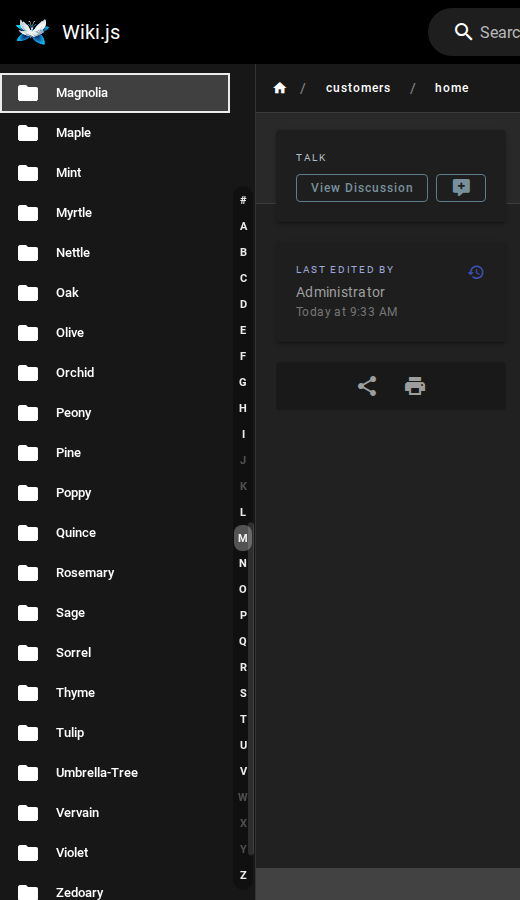

# Wiki.js Tweaks

<!-- SPDX-License-Identifier: AGPL-3.0-only -->

Small, optional interface tweaks for **Wiki.js 2.x**, delivered as **one script** that you
paste into the theme's *Code Injection*. **Every tweak is off until you turn it on**, and
nothing in Wiki.js itself is modified, so updating Wiki.js stays as easy as before.



*(Screenshot from a test wiki with invented folder names.)*

## Tweaks

| Tweak | What it does | Option |
|---|---|---|
| **[Folder index](docs/features/folder-index.md)** | An A–Z strip, like the tabs of an address book, in the sidebar of folders with many subfolders (default: more than 20). One click jumps to the first folder of a letter. | `folderIndex` |

More tweaks will be added over time; each one is documented on its own page and is **off by default**.

## Install in three steps

1. Download `wikijs-tweaks.js` (and `SHA256SUMS`) from the [latest release](https://github.com/IspiroDevelopers/wikijs-tweaks/releases/latest), or build it yourself (`npm ci && npm run build`).
2. In Wiki.js open **Administration → Theme → Code Injection** and paste into **Body HTML**:

   ```html
   <script>
   window.WikiJsTweaks = {
     folderIndex: { enabled: true }
   };
   </script>
   <script>
   /* the whole content of wikijs-tweaks.js goes here */
   </script>
   ```

3. Save, reload a page, open a folder with many subfolders. In the browser console,
   `WikiJsTweaks.status()` tells you what is running.

The full guide, including how to check the download and how to serve the file from your own
server instead of pasting it, is in **[docs/installation.md](docs/installation.md)**.

## Principles

- **Opt-in.** A fresh install does nothing. A new version never changes your wiki's look unless you enabled that tweak.
- **Nothing to patch.** One script in the theme's code injection. No Wiki.js files, no database changes, no rebuild; the setting lives in Wiki.js and survives its updates.
- **Local and quiet.** The script reads the page it runs on and adds interface elements. It makes **no network requests**, stores nothing in the browser, loads no libraries and never evaluates strings as code. A test fails the build if that ever changes.
- **Fails safe.** If Wiki.js changes the markup a tweak depends on, the tweak simply does not appear (and `status()` says why); it never breaks the page.
- **Checked against real Wiki.js.** Every change runs in a real browser against official Wiki.js images; see [compatibility](docs/compatibility.md).

## Documentation

| | |
|---|---|
| Getting started | [Installation](docs/installation.md) · [Configuration](docs/configuration.md) · [Upgrading](docs/upgrading.md) |
| Tweaks | [Folder index](docs/features/folder-index.md) |
| When something is wrong | [Troubleshooting](docs/troubleshooting.md) · [Compatibility](docs/compatibility.md) |
| Contributing | [Contributing](CONTRIBUTING.md) · [Development](docs/development.md) · [Architecture](docs/architecture.md) · [Decisions](docs/adr/README.md) · [Changelog](CHANGELOG.md) |
| Security | [Security policy](SECURITY.md) |

## Disclaimer

This is an independent community project. It is **not affiliated with, endorsed by or
supported by Wiki.js or its authors.** Code you paste into the theme's code injection runs
in the browser of every reader of your wiki with the same rights as Wiki.js itself: read
what you paste (the build is plain, readable JavaScript), check it against `SHA256SUMS`, and
keep a copy of your previous Code Injection settings before changing them. The software is
provided as is, without warranty (see sections 15 and 16 of the [license](LICENSE)).

## License

[GNU Affero General Public License v3.0 only](LICENSE) (`AGPL-3.0-only`), the same as Wiki.js.
The script is delivered to browsers as readable source, which is its Corresponding Source;
if you modify it and publish it to others, publish your changes under the same license.
